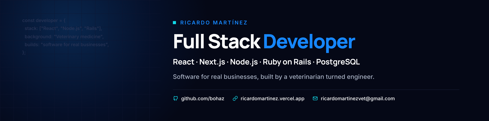

Full Stack Developer working with **React, TypeScript, Node.js and PostgreSQL/Supabase**. I build software that real businesses use every day, including the app that runs the dog grooming salon I co-own in Chile.

Before code I was a veterinarian and farm manager, so I'm used to sitting with the people who will use the product, learning how they work and shipping something that fits.

Based in Chile (UTC−3) · **Open to remote roles**

## Featured work

| Project | What it is | Stack | Links |
| --- | --- | --- | --- |
| **[Vigía SMS](https://github.com/bohaz/sms-pilot)** | Safety management system for airline operators, structured on ICAO Annex 19. Occurrence reports, risk matrix, corrective actions and a tamper-evident audit log (SHA-256 hash chain). | Next.js 15 · TypeScript · Zustand · Vitest | [Demo](https://vigiasmspilot.vercel.app) · [Code](https://github.com/bohaz/sms-pilot) |
| **[Pet Fashion Gestión](https://github.com/bohaz/petfashion-app-2)** | The app my business runs on: appointments, dog directory, pricing rules and finances. Two people use it at once from their phones, synced in real time. | Next.js 15 · TypeScript · Supabase (RLS, Realtime) · PWA | Private app · [Code](https://github.com/bohaz/petfashion-app-2) |
| **[VetGest](https://github.com/bohaz/vetgest)** | Multi-tenant SaaS for veterinary clinics, in pilot. Patients, inventory and sales in two currencies, with an offline queue that syncs in order when the signal returns. | React · Vite · Supabase (RLS) · PGlite | [Demo](https://vetgest-theta.vercel.app) · [Code](https://github.com/bohaz/vetgest) |
| **[Arpegios](https://github.com/bohaz/llanero-tonos)** | Tool for llanero harp players: repertoire by key, a microphone tuner and a key transposer. | React 19 · Vite · Web Audio API · Vitest | [Demo](https://llanero-tonos.vercel.app) · [Code](https://github.com/bohaz/llanero-tonos) |
| **[Portfolio](https://github.com/bohaz/ricardo_portfolio)** | Bilingual site (English and Spanish) with my apps, client websites and case studies. | Astro · Tailwind CSS | [Site](https://ricardomartinez.vercel.app) · [Code](https://github.com/bohaz/ricardo_portfolio) |

## How I work

- Tests on the business logic, plus ESLint, Prettier and CI on every pull request.
- Small pull requests with a preview deploy, reviewed before merging.
- A README in every repo that explains what the project does and how to run it.

## Stack

**Frontend:** React, Next.js, TypeScript, React Native, Tailwind CSS, Framer Motion 
**Backend:** Node.js, Express, Ruby on Rails 
**Data and infrastructure:** PostgreSQL, Supabase, Firebase, Vercel, Railway, AWS Amplify 
**Testing and tooling:** Vitest, Testing Library, RSpec, GitHub Actions

## Contact

[Portfolio](https://ricardomartinez.vercel.app) · [LinkedIn](https://www.linkedin.com/in/ricardo-mart%C3%ADnez-%E2%88%B4-a6810398) · [ricardomartinezvet@gmail.com](mailto:ricardomartinezvet@gmail.com)
